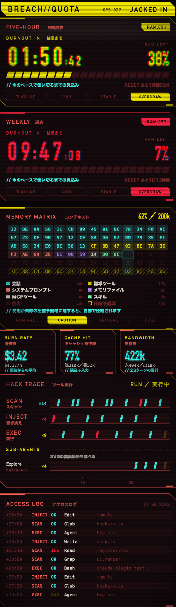
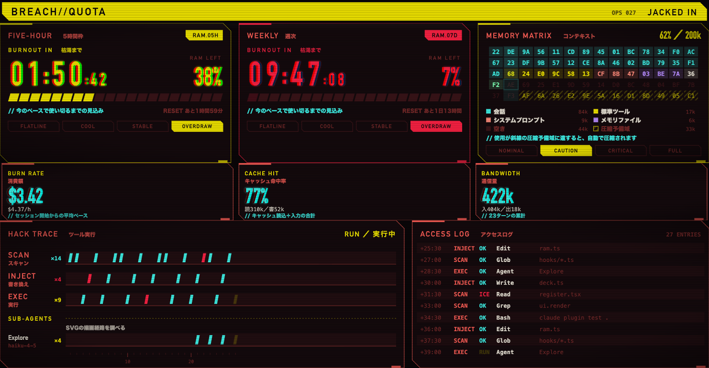

# breach-quota

[English](README.md) | 日本語

Claude Codeのサイドパネルに、酸性イエローとサーモンレッドのサイバーデッキ風HUDを出すプラグインです。[jnk0vc/netdive-quota](https://github.com/jnk0vc/netdive-quota)から表示する情報とロジックを受け継ぎ、画面の構成と言葉づかいを作り直しています。



パネルの幅が広いときは、計器3基ぶんを横に並べ、ハックトレースの右にアクセスログを置きます。



## 表示内容

**ヘッダー帯**

- 黄色の帯の左に`BREACH//QUOTA`、右にツールの実行回数（`OPS 027`）と状況を出します。状況は`STANDBY`（待機）、`JACKED IN`（実行中）、`LINK OK`（直前の実行が成功）、`ICE HIT`（直前の実行が遮断・失敗）の4つです。

**RAM計器（利用枠のタイマー）**

- 5時間枠と週次の利用枠を、数え下ろしの数字と20個のRAMブロックで表示します。報告された利用枠を最大3基まで並べます。
- RAMブロックは残量（100% − 使用率）を示します。右上の番号は枠の長さで、`RAM.05H`は5時間枠、`RAM.07D`は週次です。`RAM.07D-F`のように末尾に頭文字が付くものはモデル別の週次です。
- 数字は「時:分」を大きく、「:秒」を小さく出します。1日以上残っているときは頭に`6D`のように日数を付けます。
- 段階は`FLATLINE`・`COOL`・`STABLE`・`OVERDRAW`の4つです。
  - `OVERDRAW`: 今のペースだとリセット前に使い切る見込みなので、使い切るまでの時間を数えます（`BURNOUT IN ／ 枯渇まで`）。
  - `STABLE` / `COOL`: リセットまで持つので、リセットまでの時間を数えます（`RECHARGE IN ／ 再充填まで`）。`COOL`は経過時間の割に使用量が半分未満のときです。
  - `FLATLINE`: 使い切った状態で、`00:00`が点滅します。
- `OVERDRAW`かどうかは、枠が始まってからの経過時間と使用率から、同じペースで使い続けたときに100%に達する時刻を見積もって決めます。その時刻がリセットより前なら`OVERDRAW`です。経過が1分未満のときと、使用率が0%のときは見積もらず、リセットまでの時間を数えます。
- 数字とRAMブロックの色は、残量と使い切る見込みで変わります。上から順に判定し、最初に当てはまった色になります。

  | 色 | 条件 |
  |---|---|
  | 赤 | 残量が20%未満（使用率80%超）、使い切った（`FLATLINE`）、`OVERDRAW`で使い切るまで30分を切った、使用率90%以上、のどれか |
  | 黄 | 残量が50%以下（使用率50%以上）か、`OVERDRAW` |
  | シアン | 上のどれにも当たらないとき |

  境界は、残量ちょうど50%で黄、ちょうど20%ではまだ黄です。赤のときは、残りの最後のRAMブロックが点滅し、残量の数字にグリッチが走ります。
- 使用率が90%以上の枠があると、入力欄の上に赤い`RAM LOW`の帯が出ます（下の「入力欄の上の帯」を参照）。

**記憶マトリクス（`MEMORY MATRIX`）**

- コンテキストの窓を16進バイトの格子で描きます。1マスが窓の一定量に当たり、使用中のマスは内訳（会話、標準ツール、メモリファイルなど）の色で塗ります。並びは使用量の大きい順で、そのあとに空き、最後に圧縮予備域が続きます。
- 斜線のマスが圧縮予備域です。使用がここに達すると、自動で圧縮されます。
- 次に埋まるマスにシアンのカーソルを置き、その列を帯で照らします。
- 最下段のランプで段階を示します。使用60%未満が`NOMINAL`、80%未満が`CAUTION`、95%未満が`CRITICAL`、それ以上が`FULL`です。
- 枠の色は、使用率50%未満でサーモンレッド、50%以上で黄、80%以上で赤です。
- 内訳は`/context`と同じ見積もりを、トークン数の計算リクエストを送らない方式で、応答のたびに取り直します。内訳が取れないうちは使用量だけで描き、使用量もまだ届いていなければ`AWAITING SCAN`と出します。
- RAM計器の下に置きます。横幅が広いときは空いた3基目の位置に置き、3基とも埋まっていれば下に全幅で置きます。

**計器（記憶マトリクスの下）**

- `BURN RATE ／ 消費額`: セッションの累計コスト（USD）と、開始からの1時間あたりの平均ペースです。開始から5分たつまではペースを出しません。
- `CACHE HIT ／ キャッシュ命中率`: 入力トークンのうち、プロンプトキャッシュから読み込んだ割合です。全ターン（サブエージェントを含む）の累計で計算します。
- `BANDWIDTH ／ 通信量`: 入力と出力のトークンの累計と、ターン数です。

**ハックトレースとアクセスログ**

- ツールの実行を3種のハックに分けます。`SCAN`はRead・Grep・Globなどの読み取り、`INJECT`はEdit・Write・NotebookEditの書き換え、`EXEC`はBashとそれ以外の実行です。
- 3種を横長のトラックに並べ、1回の実行を1列として刻みます。右端が最新です。結果に応じて、成功（`OK`）はシアン、遮断・失敗（`ICE`）は赤、実行中（`RUN`）は黄の点滅で表示します。トラックの下には10回ごとに通し番号を振ります。
- その下の`SUB-AGENTS`には、サブエージェントを1体1トラックで並べます。種類・モデル・実行回数を左に、作業内容をトラックの上に表示し、その機体が行った実行を3種のトラックと同じ列に重ねて刻みます。実行中の機体を優先して、最大3体まで出します。
- アクセスログには、経過時間・ハック・結果・ツール・対象を等幅で1行ずつ記録します。行数はパネルの高さに合わせます。

**入力欄の上の帯**

- Bashの実行中は、黄で`EXEC 実行中`とコマンドを表示します。
- ツールが遮断・失敗すると、赤で`ICE 遮断`と理由を表示します。`確認`を押すか、次のプロンプトを送ると消えます。
- 利用枠の使用率が90%を超えると、赤で`RAM LOW 残量わずか`を表示します。使い切ったときは`FLATLINE 停止`です。
- Claudeの作業中は、シアンで`JACKED IN 接続中`を表示します。

**ブラウン管の効果**

- カラーのブラウン管に見立てて、パネル全体に走査線を重ね、ヘッダー帯を除く各段の四隅をわずかに暗くします。
- 大きな数字（数え下ろし・残量・計器の値）は、赤とシアンを左右にずらして描きます。カラーのブラウン管で起きる色ずれを模したものです。
- RAM計器の上を、淡い走査帯が9秒ごとに上から下へ流れます。
- ヘッダーのロゴと、赤の段階の残量には、ときどきグリッチが走ります。
- OSの「視差効果を減らす」が有効なときは、グリッチ・点滅・走査帯を止めます。

## 使い方

Claude Codeで次の2つを実行してインストールします。

```
/plugin marketplace add jnk0vc/breach-quota
/plugin install breach-quota@breach-quota
```

パネルは幅が足りるときに自動で開きます。`/breach`でいつでも開けます。

netdive-quotaと同時に有効にすると、入力欄の上の帯を2つのプラグインが取り合います。どちらか一方を有効にしてください。

## 動作条件

- 関数フックのプラグイン（早期アクセス機能）に対応したClaude Codeが必要です。2.1.288で読み込みとテストを確認しています。
- この機能が既定でオフの版では、`CLAUDE_CODE_ENABLE_FUNCTION_HOOKS=1`を付けて起動してください。
- デスクトップのCodeタブはSVGで計器盤を描きます。ターミナルでは同じ内容を色付きの文字で並べます。
- 利用枠のタイマーにはClaudeのサブスクリプションが必要です。ない場合はRAM計器が出ず、記憶マトリクスから下だけが出ます。

## デザインについて

- 近未来もののゲームやアニメに見られるHUD表現を参考にしています。参考にしたのは、黒地に黄・赤・シアンを効かせた配色、角を斜めに落とした板、色がずれるグリッチ、16進ダンプ、カラーブラウン管の走査線と色ずれといった一般的な表現手法です。特定の作品の図案・ロゴ・キャラクター・作品固有の用語は使っていません。
- 数字はDIN Condensed（ない場合はBahnschrift、Arial Narrow）、英字の見出しはDIN Alternate、日本語はヒラギノ角ゴシック（ない場合は游ゴシック、Noto Sans JP）、ログは等幅フォントで描きます。フォントは同梱していません。
- 特定の作品・権利者とは関係ありません。

## License

[MIT](LICENSE)。元になった[netdive-quota](https://github.com/jnk0vc/netdive-quota)と同じ著作権表示を含みます。
